<!-- Титульная страница. Заполните поля в квадратных скобках перед сдачей. -->

<div align="center">

**[Полное наименование учебного заведения]**

[Факультет / институт]

[Кафедра]

<br><br>

## ОТЧЁТ

### по лабораторной работе № 1

**«Основы языка C# и платформы .NET»**

по дисциплине «[Наименование дисциплины]»

**Вариант:** учёт продажи конфет кондитерской фабрикой

<br><br>

</div>

| | |
|---|---|
| Выполнил(а): | студент(ка) группы [номер группы] [Фамилия Имя Отчество] |
| Проверил(а): | [должность, учёная степень] [Фамилия И. О. преподавателя] |
| Дата сдачи: | [ДД.ММ.ГГГГ] |

<div align="center">

[Город] — [Год]

</div>

---

## Содержание

1. [Цель работы](#1-цель-работы)
2. [Вариант задания](#2-вариант-задания)
3. [Постановка задачи](#3-постановка-задачи)
4. [Предметная область и модель](#4-предметная-область-и-модель)
5. [Архитектура приложения](#5-архитектура-приложения)
6. [Архитектура платформы .NET](#6-архитектура-платформы-net)
7. [Возможности C#, использованные в работе](#7-возможности-c-использованные-в-работе)
8. [Основные алгоритмы](#8-основные-алгоритмы)
9. [Ключевые листинги](#9-ключевые-листинги)
10. [Инструкция по запуску](#10-инструкция-по-запуску)
11. [Результаты тестирования](#11-результаты-тестирования)
12. [Проверка кроссплатформенности](#12-проверка-кроссплатформенности)
13. [Снимки экрана](#13-снимки-экрана)
14. [Контрольные вопросы](#14-контрольные-вопросы)
15. [Выводы](#15-выводы)

---

## 1. Цель работы

Изучить архитектуру платформы .NET (CLR, CTS, CLS, BCL, сборки, JIT-компиляция, сборка мусора) и базовые
средства языка C#: систему типов (типы-значения и ссылочные типы, упаковка, nullable-типы), свойства,
современные синтаксические конструкции, обобщённые коллекции, делегаты, лямбда-выражения и события,
освобождение ресурсов через `IDisposable`/`using`, обработку исключений. Закрепить материал разработкой
законченного консольного приложения с автоматическими тестами, которое собирается и работает в Linux и Windows.

## 2. Вариант задания

**Учёт продажи конфет кондитерской фабрикой.**

## 3. Постановка задачи

Разработать консольное приложение для кондитерской фабрики, которое позволяет:

* вести ассортимент конфет: просматривать, добавлять, изменять и удалять виды конфет; удаление запрещено, если
  по виду конфет уже были продажи;
* учитывать остатки продукции на складе и поступление новых произведённых партий;
* искать конфеты по названию, фильтровать по категории, цене и состоянию остатка, сортировать по названию,
  цене или остатку;
* оформлять продажи: выбирать конфеты, указывать массу в килограммах, проверять корректность количества и
  достаточность остатка, автоматически рассчитывать стоимость и уменьшать остаток;
* хранить историю продаж так, чтобы изменение цены или названия конфет не меняло уже проведённые продажи;
* просматривать и искать продажи (по дате, периоду, названию конфет, покупателю);
* рассчитывать выручку за период и за всё время, строить рейтинг самых продаваемых конфет;
* корректно обрабатывать ошибочный ввод без аварийного завершения.

Ограничения: консольный интерфейс на русском языке, без базы данных и внешних сервисов; платформа .NET 8,
язык C# 12; бизнес-логика должна быть доступна автоматическим тестам без имитации клавиатуры.

## 4. Предметная область и модель

Фабрика выпускает конфеты нескольких категорий и продаёт их на развес магазинам, кафе, оптовым покупателям
и в розницу. Каждая продажа — отгрузка определённой массы одного вида конфет по действующей отпускной цене.
Отпускные цены со временем меняются, но в учёте продажа должна остаться с той ценой, по которой она прошла.

### 4.1. Классы и типы предметной области

| Тип | Вид | Назначение |
|---|---|---|
| `Candy` | `sealed class` | Вид конфет: код, название, категория, цена за кг, остаток на складе |
| `Sale` | `sealed class`, неизменяемый | Проведённая продажа: снимок названия и цены на момент продажи, масса, дата, покупатель, сумма |
| `ConfectioneryFactory` | `sealed class` | Ассортимент, склад, история продаж, поиск, отчёты, событие `SaleCompleted` |
| `CandyCategory` | `enum` | Категории: шоколадные, карамель, ириски, мармелад, драже, помадные, суфле |
| `SalesPeriod` | `readonly struct` | Отчётный период с проверкой границ |
| `CandySalesSummary` | `readonly record struct` | Строка отчёта «самые продаваемые конфеты» |
| `SaleCompletedEventArgs` | `sealed class : EventArgs` | Данные события об успешной продаже |
| `CandySortField` | `enum` | Поле сортировки ассортимента |
| `BusinessRuleException` | `sealed class : Exception` | Нарушение правил предметной области с сообщением для пользователя |
| `DomainValidation` | `internal static class` | Общие правила проверки названий, цен, масс |

### 4.2. Данные вида конфет (`Candy`)

| Свойство | Тип | Правило |
|---|---|---|
| `Id` | `int`, `required`, `init` | Положительный, задаётся фабрикой при добавлении, далее не меняется |
| `Name` | `string`, `required` | Непустое, не длиннее 60 символов, уникально в ассортименте (без учёта регистра) |
| `Category` | `CandyCategory`, `required` | Только определённые значения перечисления |
| `PricePerKg` | `decimal`, `required` | 0 < цена ≤ 100 000 руб., не более двух знаков после запятой |
| `StockKg` | `decimal`, `init` + методы | ≥ 0, с точностью до грамма; меняется только методами `AddStock` и `RemoveStock` |
| `IsInStock` | `bool`, вычисляемое | `StockKg > 0` |

Производитель отдельно не хранится: все конфеты выпускает одна фабрика, её название хранится в
`ConfectioneryFactory.Name`.

### 4.3. Данные продажи (`Sale`)

| Свойство | Тип | Комментарий |
|---|---|---|
| `Id` | `int` | Номер продажи |
| `CandyId` | `int` | Ссылка на вид конфет (по коду) |
| `CandyName` | `string` | Название **на момент продажи** |
| `QuantityKg` | `decimal` | Масса, > 0, до грамма |
| `PricePerKg` | `decimal` | Цена **на момент продажи** |
| `SoldAt` | `DateTime` | Дата и время; не может быть в будущем |
| `CustomerName` | `string?` | Покупатель; `null` — розничная продажа |
| `Total` | `decimal`, вычисляемое | `Math.Round(QuantityKg × PricePerKg, 2, MidpointRounding.AwayFromZero)` |

Все свойства продажи имеют аксессор `init`, поэтому после создания объект изменить нельзя. Для денежных сумм и
масс используется `decimal` — десятичный тип без ошибок двоичного представления (в отличие от `double`,
где `0.1 + 0.2 != 0.3`).

### 4.4. Правила предметной области

1. Количество при продаже и масса партии — строго больше нуля, точность — 1 грамм.
2. Нельзя продать больше, чем есть на складе; при отказе остаток и история не меняются.
3. Остаток не может стать отрицательным.
4. Цена — положительная, в рублях с копейками.
5. Вид конфет с продажами удалить нельзя: продажа ссылается на него по коду.
6. Продажа фиксирует название и цену на момент оформления.
7. Остаток ниже 20 кг считается заканчивающимся — после такой продажи выводится предупреждение.

## 5. Архитектура приложения

Приложение — один проект (`CandySales.csproj`) и тестовый проект (`CandySales.Tests.csproj`). Код разделён на три
папки-пространства имён с однонаправленными зависимостями:

```text
ConsoleUi  ──►  Domain  ◄──  Infrastructure
    │                              ▲
    └────────── Program.cs ────────┘
```

* **`CandySales.Domain`** — предметная модель и бизнес-логика. Не использует `Console`, поэтому полностью
  проверяется тестами. Источник текущего времени передаётся в `ConfectioneryFactory` делегатом `Func<DateTime>`,
  что позволяет тестам фиксировать «сейчас».
* **`CandySales.Infrastructure`** — работа с файлом (`SalesJournal`) и демонстрационные данные (`DemoData`).
* **`CandySales.ConsoleUi`** — диалог с пользователем: меню (`SalesConsoleApp`), ввод с повтором (`ConsoleInput`),
  разбор строк (`InputParser`), форматированный вывод (`ConsoleView`), учебный пример (`CSharpFeaturesDemo`).
* **`Program`** — точка входа: настраивает кодировку и культуру консоли, создаёт фабрику, загружает
  демонстрационные данные, открывает журнал (`using`), подписывает его на событие и запускает меню.

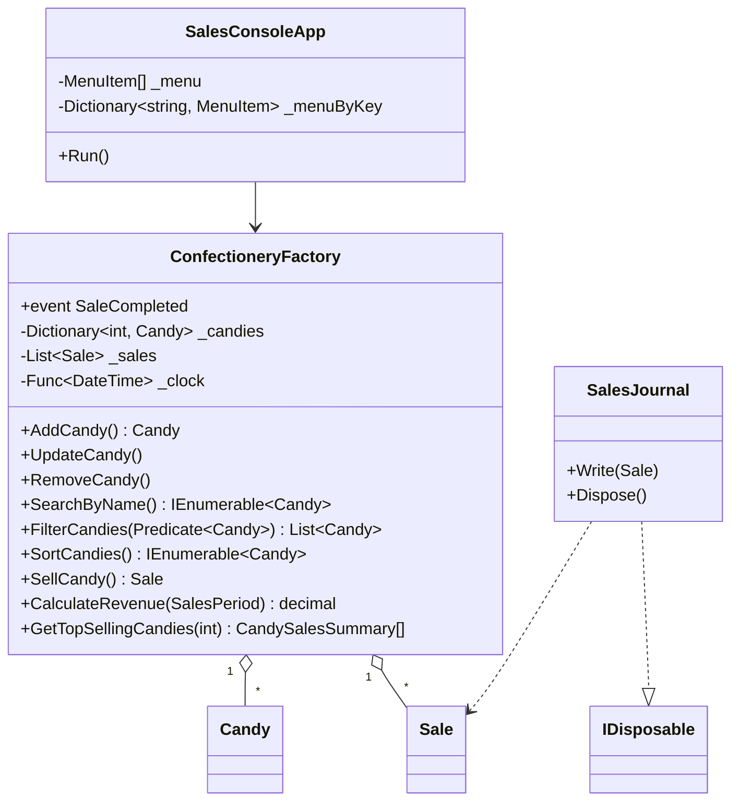

Ошибки делятся на три группы:

| Группа | Исключение | Где обрабатывается |
|---|---|---|
| Неверный формат ввода | `FormatException` (из `InputParser`) | `ConsoleInput.Read<T>` — сообщение и повторный запрос |
| Нарушение правил предметной области | `BusinessRuleException` | `ConsoleInput.Read<T>` (при вводе поля) или `SalesConsoleApp.Execute` (при выполнении операции) |
| Закрытие входного потока (Ctrl+D / Ctrl+Z, конец файла) | `EndOfStreamException` | `Program.Main` — штатное завершение |
| Ошибки ввода-вывода журнала | `IOException`, `UnauthorizedAccessException` | `Program` — предупреждение, работа продолжается |

Ошибки программиста (например, `null` вместо делегата, неизвестное значение перечисления в `switch`) не
перехватываются: `ArgumentNullException`, `ArgumentOutOfRangeException` должны проявиться сразу, а не маскироваться.
Широкий `catch (Exception)` и пустые блоки `catch` в проекте не используются.

## 6. Архитектура платформы .NET

### 6.1. Основные понятия

**CLR (Common Language Runtime)** — среда выполнения .NET. Загружает сборки, проверяет и компилирует CIL в
машинный код (JIT), управляет памятью (сборщик мусора), обрабатывает исключения, обеспечивает безопасность типов,
потоки, взаимодействие с неуправляемым кодом (P/Invoke). В .NET 8 используется реализация CoreCLR; программа
`CandySales` запускается на `Microsoft.NETCore.App 8.0.32`.

**CTS (Common Type System)** — общая система типов, описывающая, какие типы может определять и использовать
код для CLR: классы, структуры, перечисления, интерфейсы, делегаты; разделение на типы-значения и ссылочные типы;
правила наследования (единственное наследование классов, множественная реализация интерфейсов), члены типов
(поля, методы, свойства, события). Ключевые слова C# — псевдонимы типов CTS: `int` = `System.Int32`,
`decimal` = `System.Decimal`, `string` = `System.String`. Все типы, включая `int`, наследуют `System.Object`.

**CLS (Common Language Specification)** — подмножество правил CTS, которое обязаны поддерживать все .NET-языки.
Если открытый API сборки соответствует CLS, его можно использовать из C#, F#, VB.NET. Примеры требований:
не использовать в открытых сигнатурах беззнаковые типы (`uint`, `ulong`), не различать открытые имена только
регистром. Соответствие проверяется компилятором при атрибуте `[assembly: CLSCompliant(true)]`. В данной работе
открытый API использует только CLS-совместимые типы (`int`, `decimal`, `string`, `DateTime`, `DateOnly`).

**BCL / FCL.** BCL (Base Class Library) — базовая библиотека: `System`, `System.Collections.Generic`,
`System.IO`, `System.Text`, `System.Globalization`, `System.Linq` и т. д. FCL (Framework Class Library) — термин
.NET Framework для всей библиотеки платформы, включая надстройки (ADO.NET, ASP.NET, Windows Forms, WPF). В
современном .NET библиотеки поставляются как «общие фреймворки»: `Microsoft.NETCore.App` (базовые библиотеки,
используется в работе), `Microsoft.AspNetCore.App`, `Microsoft.WindowsDesktop.App`. Приложение использует только
BCL — сторонних пакетов в нём нет.

**Сборка (assembly)** — единица развёртывания, версионирования и повторного использования: PE-файл
(`.dll`/`.exe`), содержащий CIL-код, метаданные о типах и манифест (имя, версия, культура, ссылки на другие
сборки). Сборка `CandySales.dll` после компиляции лежит в `bin/Release/net8.0/` вместе с файлами
`CandySales.runtimeconfig.json` (какая версия среды нужна), `CandySales.deps.json` (зависимости) и запускающим
файлом `CandySales` (в Windows — `CandySales.exe`, apphost). Одна и та же `CandySales.dll` запускается командой
`dotnet CandySales.dll` и в Linux, и в Windows: CIL не зависит от процессора и ОС.

**Управляемый код** — код, выполнением которого управляет CLR: память выделяется в управляемой куче и
освобождается сборщиком мусора, обращения к массивам проверяются на выход за границы, приведения типов
проверяются (пример — `InvalidCastException` при неправильной распаковке в пункте меню 14), исключения
раскручивают стек с выполнением `finally`. Неуправляемый код (например, функции ОС) вызывается через P/Invoke;
ресурсы ОС (файловые дескрипторы) требуют явного освобождения — отсюда `IDisposable`.

**JIT-компиляция.** Компилятор C# (Roslyn) переводит исходный текст в CIL. Машинный код создаётся JIT-компилятором
(RyuJIT) при первом вызове метода. В .NET 8 включена многоуровневая компиляция: сначала быстрый код (tier 0),
затем для часто вызываемых методов — оптимизированный (tier 1), с использованием динамических профилей (Dynamic PGO).
Альтернативы: ReadyToRun (предкомпиляция части кода при публикации) и Native AOT (полная компиляция в машинный код
без JIT). В данной работе используется обычная JIT-компиляция.

**Garbage Collector** — сборщик мусора с поколениями. Новые объекты создаются в поколении 0; пережившие сборку
переходят в поколения 1 и 2. Крупные объекты (от 85 000 байт) размещаются в куче больших объектов (LOH). Сборщик
находит недостижимые объекты, освобождает память и уплотняет кучу. Момент сборки недетерминирован, поэтому
ресурсы, отличные от памяти (файлы, сокеты), освобождаются явно через `Dispose()`; финализатор служит лишь
страховкой у классов, напрямую владеющих неуправляемым дескриптором (в .NET это обычно `SafeHandle`).

### 6.2. Сравнение CLR и JVM

| Критерий | CLR (.NET) | JVM (Java) |
|---|---|---|
| Промежуточный код | CIL (MSIL) в PE-файлах сборок `.dll`/`.exe` | Байт-код в `.class`-файлах, упаковываются в JAR |
| Единица развёртывания | Сборка с манифестом и метаданными | JAR-архив; с Java 9 — модули (JPMS) |
| Выполнение | JIT (RyuJIT) с многоуровневой компиляцией; ReadyToRun; Native AOT. Интерпретатора CIL в CoreCLR .NET 8 нет | Интерпретатор + JIT-компиляторы C1/C2 (HotSpot); AOT — GraalVM Native Image |
| Система типов | CTS: пользовательские типы-значения (`struct`), перечисления — отдельные типы-значения; все типы, включая `int`, наследуют `System.Object` | Примитивные типы вне иерархии объектов (`int` и `Integer`); пользовательских типов-значений в стандартной Java нет |
| Обобщения | Реифицированные: `List<int>` существует во время выполнения, для типов-значений генерируется отдельный код без упаковки | Стирание типов: во время выполнения `List<Integer>` — просто `List`, примитивы упаковываются |
| Языки | C#, F#, VB.NET; совместимость обеспечивают CTS и CLS | Java, Kotlin, Scala, Groovy, Clojure |
| Сборка мусора | Поколенческий GC (0/1/2, LOH, POH), режимы Workstation/Server, фоновая сборка | Набор сборщиков на выбор: G1 (по умолчанию), ZGC, Shenandoah, Parallel, Serial |
| Детерминированное освобождение | `IDisposable` + `using` | `AutoCloseable` + `try-with-resources` |
| Свойства и события | Члены типа в метаданных (`property`, `event`) | Соглашение об именах `getX()/setX()`; событий нет, используется шаблон «слушатель» |
| Указатели и `unsafe` | Поддерживаются (`unsafe`, `fixed`, `Span<T>`) | Нет; низкоуровневый доступ — `Unsafe`/Foreign Function & Memory API |
| Вызов нативного кода | P/Invoke, `LibraryImport` | JNI, Foreign Function & Memory API (Java 22+) |
| Исключения | Непроверяемые: компилятор не требует объявлять их в сигнатуре | Есть проверяемые (checked) исключения |
| Беззнаковые целые | Есть (`byte`, `uint`, `ulong`), но не входят в CLS | Нет (кроме `char`) |
| Стандартная библиотека | BCL / общий фреймворк `Microsoft.NETCore.App` | Java SE API (Java Class Library) |
| Платформы | Windows, Linux, macOS (x64, Arm64), а также мобильные платформы | Любая платформа, для которой есть реализация JVM |

## 7. Возможности C#, использованные в работе

### 7.1. Типы-значения и ссылочные типы, `struct` и `class`

Переменная **типа-значения** (`int`, `decimal`, `DateTime`, `enum`, любая `struct`) содержит сами данные;
присваивание копирует значение целиком. Локальные переменные таких типов хранятся в стеке или в регистрах, а
поля — внутри объекта-владельца. Переменная **ссылочного типа** (`class`, `string`, массив, делегат) содержит
ссылку на объект в управляемой куче; присваивание копирует только ссылку, и обе переменные указывают на один объект.

В проекте:

* `Candy`, `Sale`, `ConfectioneryFactory` — классы: у них есть идентичность, изменяемое состояние (остаток, цена)
  или большой объём данных; их передают по ссылке.
* `SalesPeriod` — `readonly struct`: две даты, неизменяемая, передаётся копированием, не создаёт нагрузку на GC.
* `CandySalesSummary` — `readonly record struct`: компилятор генерирует сравнение по значению, `ToString`,
  выражение `with`. Используется в `GetTopSellingCandies` для накопления итогов:
  `summary with { TotalKg = summary.TotalKg + sale.QuantityKg, ... }`.
* В пункте меню 14 (`CSharpFeaturesDemo`) наглядно показано, что изменение копии структуры не влияет на
  оригинал, а изменение объекта класса через вторую переменную видно через первую (`ReferenceEquals == True`).

### 7.2. Boxing и unboxing

**Упаковка (boxing)** — преобразование типа-значения в `object` (или интерфейс): в куче создаётся объект, в
который копируется значение. **Распаковка (unboxing)** — явное приведение `object` к исходному типу-значению с
копированием значения обратно; приводить можно только к точному исходному типу, иначе `InvalidCastException`.
Упаковка стоит выделения памяти и последующей сборки мусора, поэтому в предметной логике её нет: обобщённые
коллекции `List<Sale>`, `Dictionary<int, Candy>`, `Dictionary<int, CandySalesSummary>` хранят значения без
упаковки. Демонстрация вынесена в изолированный учебный пример `CSharpFeaturesDemo.ShowBoxing`:

```csharp
int boxesInStock = 42;
object boxed = boxesInStock;  // boxing: копия значения помещается в объект в управляемой куче
boxesInStock = 50;
int unboxed = (int)boxed;     // unboxing: явное приведение к точному исходному типу → 42
(long)boxed                   // InvalidCastException: упакован int, а не long
```

Там же массив `object?[] values = [42, 12.5m, ...]` — неявная упаковка `int` и `decimal` при помещении в массив
`object`.

### 7.3. Nullable value types и nullable reference types

`T?` для типа-значения — это `Nullable<T>`: структура со свойствами `HasValue` и `Value`. В проекте:

* `UpdateCandy(int id, string? newName = null, CandyCategory? newCategory = null, decimal? newPricePerKg = null)` —
  `null` означает «не менять»; в интерфейсе пустой ввод (Enter) превращается в `null` методом
  `ConsoleInput.ReadOptional<T>`, возвращающим `T?`;
* `SellCandy(..., DateTime? soldAt = null)` — `null` означает «текущее время»: `var moment = soldAt ?? now;`;
* `SalesPeriod? period` в расчёте выручки — для общей выручки период не задаётся;
* `int? number` при выборе категории, `int? exceptCandyId` при проверке уникальности названия.

**Nullable reference types** включены для всех проектов настройкой `<Nullable>enable</Nullable>` в
`lab1/Directory.Build.props`; в файле `CSharpFeaturesDemo.cs` дополнительно показана директива
`#nullable enable`, управляющая режимом на уровне файла. При включённом режиме `string` означает «не может быть
null», `string?` — «может быть null», и компилятор предупреждает о разыменовании возможного `null`. Поскольку
включён `TreatWarningsAsErrors`, такие предупреждения ломают сборку. Примеры: `Candy? FindCandy(int id)`,
`string? CustomerName`, `SalesJournal? TryOpenJournal(...)`, `event EventHandler<SaleCompletedEventArgs>? SaleCompleted`.

### 7.4. Свойства

Свойство C# — член типа с аксессорами `get`/`set`/`init`, который используется синтаксисом поля, а компилируется
в методы `get_Name`/`set_Name`, отражённые в метаданных как свойство. В проекте используются:

| Вид | Пример | Где |
|---|---|---|
| Полное свойство с проверкой в `set` | `Name { get => _name; set => _name = DomainValidation.RequireText(value, ...); }` | `Candy.Name`, `Candy.PricePerKg`, `Candy.Category` |
| Автоматически реализуемое | `public required int Id { get; init; }`, `public string? CustomerName { get; init; }` | `Sale` |
| Только для чтения | `public string Name { get; }` — задаётся в конструкторе | `ConfectioneryFactory.Name`, `SalesPeriod.From/To` |
| Вычисляемое | `public decimal Total => CalculateTotal(QuantityKg, PricePerKg);` | `Sale.Total`, `Candy.IsInStock`, `SaleCompletedEventArgs.IsStockLow` |
| `init` | `StockKg { get => _stockKg; init => _stockKg = DomainValidation.RequireStock(value); }` — начальный остаток задаётся только в инициализаторе объекта | `Candy.StockKg`, `Candy.Id`, все свойства `Sale` |
| `required` (C# 11+) | `public required decimal PricePerKg { ... }` — компилятор не даст создать объект без этого свойства | `Candy`, `Sale` |

Корректность состояния обеспечена тем, что каждое изменение проходит через проверку в аксессоре: присвоить
`PricePerKg = -5` нельзя — будет `BusinessRuleException`, прежнее значение сохранится (это проверяет тест
`ChangingPrice_ToInvalidValue_KeepsPreviousPrice`). Остаток невозможно изменить присваиванием вообще — только
методами `AddStock` (публичный) и `RemoveStock` (`internal`, вызывается фабрикой после всех проверок).

**Отличие от Java.** В Java нет свойств на уровне языка: поле закрывается модификатором `private`, а доступ
организуется методами `getPrice()`/`setPrice(...)` по соглашению JavaBeans; вызывающий код пишет
`candy.setPrice(candy.getPrice() + 10)`. В C# то же записывается как `candy.PricePerKg += 10`, при этом
сохраняется инкапсуляция — выполняется код аксессоров. Автосвойства избавляют от ручного объявления поля, `init`
и `required` дают неизменяемость и обязательность на уровне компилятора (в Java аналог — конструктор или
`record`, где компоненты доступны методами `price()`). Свойства — полноценные члены метаданных, их видят
отражение, сериализаторы и IDE.

### 7.5. Синтаксические возможности

| Конструкция | Пример из проекта |
|---|---|
| `var` | `var candy = GetCandy(candyId);`, `var totals = new Dictionary<int, CandySalesSummary>();` — тип очевиден из правой части |
| Интерполяция строк | `$"Недостаточно конфет «{candy.Name}» на складе: запрошено {quantityKg:0.###} кг"`, выравнивание `{candy.Id,4}`, формат `{candy.PricePerKg,12:N2}` |
| `nameof` | `throw new ArgumentOutOfRangeException(nameof(field), ...)`; заголовок CSV в `SalesJournal`: `nameof(Sale.Id), nameof(Sale.SoldAt), ...` — при переименовании свойства заголовок изменится вместе с ним |
| `using`-директивы | В каждом файле явно (`ImplicitUsings` отключены): `using System.Collections.Generic;`, `using CandySales.Domain;` |
| `using`-объявление и `using`-блок | `using var journal = TryOpenJournal(...);` в `Program`; `using (var journal = new SalesJournal(path)) { ... }` в тестах |
| Pattern matching | `if (ReadCandyOrCancel(...) is not { } candy) return;`, `if (newPricePerKg is decimal price)`, `sale.CustomerName is { } customer && ...`, `period is { } selected`, типовые шаблоны в `CSharpFeaturesDemo.Describe` |
| Switch-выражения | `CandyCategory.ToDisplayName()`, `SortCandies` (выбор ключа сортировки), выбор `Predicate<Candy>` в меню фильтра, `DescribeStock` с константным (`0m`) и относительным (`< LowStockThresholdKg`) шаблонами, `ParseYesNo` с шаблоном `or` |
| Выражения коллекций (C# 12) | `_menu = [ new("1", ...), ... ];`, `string[] fields = [ ... ];` |
| Файловые пространства имён | `namespace CandySales.Domain;` |

### 7.6. Коллекции

| Коллекция | Где и зачем |
|---|---|
| Массив `T[]` | `MenuItem[] _menu` — фиксированный порядок пунктов меню; `CandyCategory[] categories = Enum.GetValues<CandyCategory>()` — выбор категории по номеру; результат `GetTopSellingCandies` — `CandySalesSummary[]` известной длины; `string[] fields` — поля строки журнала |
| `List<T>` | `List<Sale> _sales` — история продаж в порядке оформления; `FilterCandies` возвращает `List<Candy>` через `List<T>.FindAll(Predicate<T>)` |
| `Dictionary<TKey, TValue>` | `Dictionary<int, Candy> _candies` — поиск вида конфет по коду за O(1) (`TryGetValue`); `Dictionary<string, MenuItem>` — выбор пункта меню по введённому ключу; `Dictionary<int, CandySalesSummary>` — накопление итогов по видам конфет |
| `IEnumerable<T>` | Результаты поиска, фильтрации, сортировки (`SearchByName`, `SortCandies`, `FindSales...`) — вызывающему коду нужен только перебор, внутренние коллекции не раскрываются для изменения |
| `foreach` | Перебор при выводе таблиц (`ConsoleView.PrintRows`), подсчёте выручки (`SumTotals`), проверке уникальности названия, проверке наличия продаж, построении рейтинга |

Из LINQ используются только `Where` (поиск, фильтры продаж) и `OrderBy` (упорядочивание по коду, дате,
названию, цене, остатку). Сортировка по убыванию сделана не отдельным оператором, а компаратором с обратным
порядком (`WithDirection`). Суммы и рейтинг вычисляются циклами `foreach`, без `Sum`, `GroupBy`, `Take` — систематическое
изучение LINQ относится к следующей работе.

### 7.7. Делегаты, лямбда-выражения и события

| Делегат | Использование |
|---|---|
| `Func<DateTime>` | Источник времени в `ConfectioneryFactory`; по умолчанию `() => DateTime.Now`, в тестах — фиксированная дата |
| `Func<Sale, bool>` | Критерий в `FindSales(Func<Sale, bool> criterion)` — общий метод для поиска по дате, периоду, названию, покупателю |
| `Func<string, T>` | Функция разбора и проверки в `ConsoleInput.Read<T>(prompt, parse)` — один цикл «запрос → проверка → повтор» для чисел, дат, цен, кодов |
| `Predicate<Candy>` | `FilterCandies(Predicate<Candy> predicate)`; в меню фильтр выбирается switch-выражением, лямбды захватывают введённые значения: `candy => candy.PricePerKg >= min && candy.PricePerKg <= max` (замыкание) |
| `Action` | Действие пункта меню: `record MenuItem(string Key, string Title, Action Execute)` |
| `Action<T>` | Вывод строки таблицы: `PrintRows<T>(IEnumerable<T> items, string header, Action<T> printRow, ...)` |
| `EventHandler<T>` | Событие `SaleCompleted` |

**Событие** `public event EventHandler<SaleCompletedEventArgs>? SaleCompleted;` объявлено в `ConfectioneryFactory`
и вызывается в конце `SellCandy` после списания товара: `SaleCompleted?.Invoke(this, new SaleCompletedEventArgs(sale, candy.StockKg));`.
На него подписаны два независимых обработчика:

1. консольный интерфейс (`SalesConsoleApp.OnSaleCompleted`) — показывает новый остаток и предупреждает, если
   он ниже 20 кг;
2. журнал продаж (лямбда в `Program`: `factory.SaleCompleted += (_, e) => WriteToJournal(journal, e.Sale);`).

Фабрика ничего не знает ни о консоли, ни о файле — это и есть смысл события. Ключевое слово `event` запрещает
внешнему коду вызывать событие или затирать список подписчиков присваиванием: снаружи доступны только `+=` и `-=`.
Подписка выполняется после загрузки демонстрационных данных, поэтому в журнал попадают только новые продажи.

### 7.8. `IDisposable` и `using`

`SalesJournal` владеет реальным ресурсом — открытым файлом (`FileStream` внутри `StreamWriter`, то есть
дескриптором ОС). Пока файл открыт, другие процессы не могут в него писать (`FileShare.Read`), а число
дескрипторов в ОС ограничено. Сборщик мусора освобождает только память и делает это в непредсказуемый момент,
поэтому файл закрывается явно в `Dispose()`:

* `Dispose()` закрывает `StreamWriter` (тот сбрасывает буфер и закрывает `FileStream`), повторный вызов безопасен;
* после `Dispose()` метод `Write` выбрасывает `ObjectDisposedException`;
* финализатор не нужен: класс не держит неуправляемый дескриптор напрямую, `FileStream` сам защищён `SafeHandle`;
  класс `sealed`, поэтому полный шаблон с `Dispose(bool)` не требуется.

В `Program.Main` используется `using`-объявление: `using var journal = TryOpenJournal(SalesJournal.DefaultFilePath);` —
компилятор превращает его в `try/finally` с вызовом `journal?.Dispose()` при выходе из метода, в том числе по
исключению. Если журнал открыть не удалось, переменная равна `null` и `using` ничего не вызывает. В тестах показан
`using`-блок и проверено, что после `Dispose` файл можно открыть с `FileShare.None` — он действительно освобождён.

Освобождать ресурсы нужно, когда объект владеет чем-то, кроме управляемой памяти: файлами, сетевыми соединениями,
подключениями к БД, таймерами, неуправляемой памятью, а также подписками, которые надо снять.

### 7.9. Исключения и проверка ввода

* `InputParser` разбирает строки независимо от региональных настроек ОС: дробная часть — запятая или точка
  (`12,5` и `12.5`), разделители тысяч и экспоненциальная запись не принимаются (`1 000`, `1e5` — ошибка),
  целые числа вне диапазона `int` — ошибка, даты — строго `ДД.ММ.ГГГГ` с проверкой существования
  (`31.02.2025` — ошибка).
* Денежные значения: `decimal`, > 0, ≤ 100 000, не более 2 знаков после запятой. Массы: > 0 (для остатка ≥ 0),
  не более 3 знаков после запятой. Проверку выполняет `DomainValidation`, общий для модели и интерфейса.
* `ConsoleInput.Read<T>` перехватывает только `FormatException` и `BusinessRuleException`, показывает сообщение
  красным и повторяет запрос того же поля — пользователь не теряет уже введённые данные.
* `SalesConsoleApp.Execute` перехватывает `BusinessRuleException` при выполнении операции (например, повторное
  название, удаление конфет с продажами) — приложение возвращается в меню.
* Закрытый входной поток (`Console.ReadLine()` вернул `null`) превращается в `EndOfStreamException` и штатное
  завершение — без бесконечного цикла.
* Ctrl+C обрабатывается подпиской на `Console.CancelKeyPress`: выводится сообщение; так как журнал пишется с
  `AutoFlush = true`, уже оформленные продажи сохранены.

## 8. Основные алгоритмы

### 8.1. Оформление продажи (`ConfectioneryFactory.SellCandy`)

1. Проверить количество: > 0, не более 3 знаков после запятой (`DomainValidation.RequireQuantity`).
2. Найти конфеты по коду (`Dictionary.TryGetValue`); если нет — `BusinessRuleException`.
3. Сравнить количество с остатком; если остатка недостаточно — `BusinessRuleException`, ничего не изменено.
4. Определить момент продажи (`soldAt ?? _clock()`), запретить дату в будущем.
5. Создать неизменяемый объект `Sale`, скопировав в него текущие название и цену за кг.
6. Списать товар со склада (`Candy.RemoveStock`), добавить продажу в `List<Sale>`, увеличить номер.
7. Вызвать событие `SaleCompleted`.

Все проверки выполняются до изменения состояния, поэтому при ошибке на любом шаге 1–5 остаток и история
не меняются (проверено тестами `SellCandy_WithInsufficientStock_ThrowsAndChangesNothing`, `SellCandy_WithInvalidQuantity_Throws`).

### 8.2. Расчёт стоимости

`Total = Math.Round(QuantityKg × PricePerKg, 2, MidpointRounding.AwayFromZero)`. Используется `decimal`, поэтому
произведение вычисляется точно, а округление до копеек выполняется по привычному денежному правилу
(половина копейки округляется вверх по модулю): `0,001 кг × 395 руб. = 0,395 → 0,40 руб.`

### 8.3. Неизменность истории

Продажа хранит не ссылку на объект `Candy`, а код, название и цену на момент продажи. Поэтому
`UpdateCandy(1, newPricePerKg: 999.99m)` меняет только карточку товара; сумма старой продажи считается от её
собственной `PricePerKg` (тест `ChangingCandyPriceAndName_DoesNotChangeSalesHistory`).

### 8.4. Выручка

Выбираются продажи, у которых дата (`DateOnly.FromDateTime(SoldAt)`) лежит в периоде включительно
(`SalesPeriod.Contains`), суммы складываются в цикле `foreach`. Общая выручка — сумма по всем продажам.

### 8.5. Самые продаваемые конфеты

1. Пройти по всем продажам, накапливая в `Dictionary<int, CandySalesSummary>` массу, выручку и число продаж
   по коду конфет (выражение `with` создаёт обновлённую копию структуры).
2. Упорядочить итоги по массе по убыванию (`OrderBy` с обратным компаратором).
3. Скопировать первые `N` элементов в массив длиной `min(N, число видов)`.

### 8.6. Сортировка ассортимента

Switch-выражение выбирает ключ (`Name`, `PricePerKg`, `StockKg`) и компаратор: для названий —
`StringComparer.CurrentCultureIgnoreCase` (алфавитный порядок кириллицы), для чисел — `Comparer<decimal>.Default`.
Для убывания компаратор оборачивается: `Comparer<T>.Create((x, y) => comparer.Compare(y, x))`.

### 8.7. Поиск и фильтрация

Поиск по названию — `Where` с `string.Contains(text, StringComparison.OrdinalIgnoreCase)` (без учёта регистра,
в том числе для кириллицы). Фильтрация — `List<T>.FindAll(Predicate<T>)`, условие передаётся лямбдой.

## 9. Ключевые листинги

**Листинг 1.** Свойства вида конфет: `required`, `init`, проверка в `set` (`Domain/Candy.cs`, фрагмент).

```csharp
public required int Id
{
    get => _id;
    init => _id = value > 0 ? value : throw new BusinessRuleException("Код конфет должен быть положительным числом.");
}

public required decimal PricePerKg
{
    get => _pricePerKg;
    set => _pricePerKg = DomainValidation.RequirePrice(value);
}

public decimal StockKg
{
    get => _stockKg;
    init => _stockKg = DomainValidation.RequireStock(value);
}

internal void RemoveStock(decimal quantityKg)
{
    DomainValidation.RequireQuantity(quantityKg);
    if (quantityKg > _stockKg)
    {
        throw new BusinessRuleException(
            $"Недостаточно конфет «{Name}» на складе: запрошено {quantityKg:0.###} кг, в наличии {_stockKg:0.###} кг.");
    }

    _stockKg -= quantityKg;
}
```

Код и начальный остаток задаются только при создании объекта; цену можно менять, но только на корректное
значение; остаток уменьшается только методом, который не допускает отрицательного результата.

**Листинг 2.** Оформление продажи и вызов события (`Domain/ConfectioneryFactory.cs`).

```csharp
public Sale SellCandy(int candyId, decimal quantityKg, string? customerName = null, DateTime? soldAt = null)
{
    DomainValidation.RequireQuantity(quantityKg);
    var candy = GetCandy(candyId);

    if (quantityKg > candy.StockKg)
    {
        throw new BusinessRuleException(
            $"Недостаточно конфет «{candy.Name}» на складе: запрошено {quantityKg:0.###} кг, в наличии {candy.StockKg:0.###} кг.");
    }

    var now = _clock();
    var moment = soldAt ?? now;
    if (moment > now)
    {
        throw new BusinessRuleException("Дата продажи не может быть в будущем.");
    }

    var sale = new Sale
    {
        Id = _nextSaleId,
        CandyId = candy.Id,
        CandyName = candy.Name,
        QuantityKg = quantityKg,
        PricePerKg = candy.PricePerKg,
        SoldAt = moment,
        CustomerName = DomainValidation.OptionalText(customerName, "Покупатель"),
    };

    candy.RemoveStock(quantityKg);
    _sales.Add(sale);
    _nextSaleId++;

    SaleCompleted?.Invoke(this, new SaleCompletedEventArgs(sale, candy.StockKg));
    return sale;
}
```

Оператор `?.` вызывает событие только при наличии подписчиков; `??` подставляет текущее время, если дата
не передана (nullable value type `DateTime?`).

**Листинг 3.** Сортировка: switch-выражение, `OrderBy`, компаратор с направлением, `nameof`.

```csharp
public IEnumerable<Candy> SortCandies(CandySortField field, bool descending = false)
{
    var candies = _candies.Values;
    return field switch
    {
        CandySortField.Name => candies.OrderBy(candy => candy.Name, WithDirection(StringComparer.CurrentCultureIgnoreCase, descending)),
        CandySortField.Price => candies.OrderBy(candy => candy.PricePerKg, WithDirection(Comparer<decimal>.Default, descending)),
        CandySortField.Stock => candies.OrderBy(candy => candy.StockKg, WithDirection(Comparer<decimal>.Default, descending)),
        _ => throw new ArgumentOutOfRangeException(nameof(field), field, "Неизвестное поле сортировки."),
    };
}

private static IComparer<T> WithDirection<T>(IComparer<T> comparer, bool descending) =>
    descending ? Comparer<T>.Create((x, y) => comparer.Compare(y, x)) : comparer;
```

**Листинг 4.** Рейтинг продаж: `Dictionary`, `record struct` + `with`, массив, `foreach`.

```csharp
var totals = new Dictionary<int, CandySalesSummary>();
foreach (var sale in _sales)
{
    totals[sale.CandyId] = totals.TryGetValue(sale.CandyId, out var summary)
        ? summary with
        {
            TotalKg = summary.TotalKg + sale.QuantityKg,
            Revenue = summary.Revenue + sale.Total,
            SalesCount = summary.SalesCount + 1,
        }
        : new CandySalesSummary(sale.CandyId, FindCandy(sale.CandyId)?.Name ?? sale.CandyName, sale.QuantityKg, sale.Total, 1);
}

var ordered = totals.Values.OrderBy(summary => summary.TotalKg, WithDirection(Comparer<decimal>.Default, descending: true));
var top = new CandySalesSummary[Math.Min(count, totals.Count)];
var index = 0;
foreach (var summary in ordered)
{
    if (index == top.Length)
    {
        break;
    }

    top[index++] = summary;
}
```

**Листинг 5.** Фильтр: `Predicate<T>`, лямбды, замыкание, target-typed switch-выражение (`ConsoleUi/SalesConsoleApp.cs`).

```csharp
Predicate<Candy> predicate = choice switch
{
    1 => CreateCategoryFilter(),
    2 => CreatePriceFilter(),
    3 => candy => candy.IsInStock,
    _ => candy => candy.StockKg < ConfectioneryFactory.LowStockThresholdKg,
};

ConsoleView.PrintCandies(_factory.FilterCandies(predicate), "Подходящих конфет нет.");

private static Predicate<Candy> CreatePriceFilter()
{
    var min = ConsoleInput.Read("Минимальная цена за кг, руб.: ", ParsePrice);
    var max = ConsoleInput.Read("Максимальная цена за кг, руб.: ", text =>
    {
        var value = ParsePrice(text);
        return value >= min ? value : throw new BusinessRuleException("Максимальная цена не может быть меньше минимальной.");
    });

    return candy => candy.PricePerKg >= min && candy.PricePerKg <= max; // лямбда захватывает min и max
}
```

**Листинг 6.** Универсальный ввод с повтором: `Func<string, T>`, перехват только ожидаемых исключений
(`ConsoleUi/ConsoleInput.cs`).

```csharp
public static T Read<T>(string prompt, Func<string, T> parse)
{
    while (true)
    {
        var text = ReadLine(prompt);
        try
        {
            return parse(text);
        }
        catch (FormatException ex)
        {
            ConsoleView.WriteError(ex.Message);
        }
        catch (BusinessRuleException ex)
        {
            ConsoleView.WriteError(ex.Message);
        }
    }
}

public static T? ReadOptional<T>(string prompt, Func<string, T> parse)
    where T : struct =>
    Read<T?>(prompt, text => string.IsNullOrWhiteSpace(text) ? null : parse(text));
```

**Листинг 7.** Журнал продаж: `IDisposable` (`Infrastructure/SalesJournal.cs`, фрагмент) и `using` в `Program.cs`.

```csharp
public void Write(Sale sale)
{
    ObjectDisposedException.ThrowIf(_disposed, this);
    ArgumentNullException.ThrowIfNull(sale);
    // ... формирование string[] fields в инвариантной культуре ...
    _writer.WriteLine(string.Join(Separator, fields));
}

public void Dispose()
{
    if (_disposed)
    {
        return;
    }

    _writer.Dispose();
    _disposed = true;
}
```

```csharp
using var journal = TryOpenJournal(SalesJournal.DefaultFilePath);
if (journal is not null)
{
    factory.SaleCompleted += (_, e) => WriteToJournal(journal, e.Sale);
}
```

**Листинг 8.** Pattern matching: константный, относительный и типовые шаблоны.

```csharp
public static string DescribeStock(decimal stockKg) => stockKg switch
{
    0m => "нет в наличии",
    < ConfectioneryFactory.LowStockThresholdKg => "заканчивается",
    _ => "в наличии",
};

private static string Describe(object? value) => value switch
{
    null => "null — значение отсутствует",
    int number and > 0 => $"положительное целое число {number}",
    decimal amount => $"decimal {amount} — подходит для денежных сумм и масс",
    string { Length: 0 } => "пустая строка",
    string text => $"строка «{text}» длиной {text.Length}",
    CandyCategory category => $"категория конфет «{category.ToDisplayName()}»",
    SalesPeriod period => $"отчётный период {period} (struct)",
    _ => $"значение типа {value.GetType().Name}",
};
```

## 10. Инструкция по запуску

Требуется .NET SDK 8.0 (установка описана в [`README.md`](../../README.md#установка-net-8-sdk)). Команды
выполняются из корня репозитория.

**Linux (Bash):**

```bash
dotnet --info
dotnet restore lab1/CandySales.sln
dotnet build lab1/CandySales.sln
dotnet run --project lab1/src/CandySales/CandySales.csproj
dotnet test lab1/CandySales.sln
```

**Windows (PowerShell):**

```powershell
dotnet --info
dotnet restore lab1\CandySales.sln
dotnet build lab1\CandySales.sln
dotnet run --project lab1\src\CandySales\CandySales.csproj
dotnet test lab1\CandySales.sln
```

Прогон всего демонстрационного сценария без ручного ввода:

```bash
dotnet run --project lab1/src/CandySales/CandySales.csproj < reports/lab1/demo-input.txt               # Linux
```

```powershell
cmd /c "dotnet run --project lab1\src\CandySales\CandySales.csproj < reports\lab1\demo-input.txt"     # Windows
```

## 11. Результаты тестирования

### 11.1. Автоматические тесты

Тестовый проект `lab1/tests/CandySales.Tests` (xUnit 2.9.3) обращается к классам предметной области напрямую,
без имитации клавиатуры. Время в тестах фиксировано (`Func<DateTime>` возвращает 15.03.2025 12:00).

| Класс тестов | Методов | Что проверяется |
|---|---:|---|
| `CandyTests` | 11 | Создание конфет; обязательные данные; пустое и слишком длинное название; неположительный код; цена ≤ 0, с тремя знаками после запятой, выше максимума; несуществующая категория; отрицательный остаток; приём партии; сохранение прежней цены при попытке задать ошибочную |
| `AssortmentTests` | 16 | Последовательные коды; запрет повторного названия без учёта регистра; поиск по фрагменту без учёта регистра; фильтрация по категории, цене, остатку (`Predicate`); сортировка по названию, цене и остатку в обе стороны; изменение только указанных полей; отсутствие частичного изменения при ошибке; приём партии; удаление без продаж и запрет удаления с продажами |
| `SalesTests` | 20 | Расчёт стоимости и округление до копеек; успешная продажа с ценой на момент продажи; уменьшение остатка; продажа всего остатка; отказ при недостаточном остатке без изменения данных; отказ при нулевом, отрицательном и слишком точном количестве; неизвестный код; дата в будущем; неизменность истории после изменения цены и названия; событие `SaleCompleted` (один вызов, правильные данные, нет вызова при ошибке); выручка за период и общая; поиск продаж по дате, названию, покупателю; хронологический порядок; рейтинг продаж |
| `SalesPeriodTests` | 3 | Проверка границ периода, включение обеих границ, копирование структуры |
| `InputParserTests` | 8 | Числа с запятой и точкой, отказ для `abc`, `1 000`, `1,2,3`, `1e5`; целые; даты `ДД.ММ.ГГГГ`, отказ для `31.02.2025`, `2025-03-05`; ответы «д/н» |
| `SalesJournalTests` | 3 | Запись заголовка и строки CSV с экранированием; дозапись без второго заголовка; `Dispose` освобождает файл, повторный `Dispose` безопасен, запись после `Dispose` — `ObjectDisposedException` |
| **Итого** | **61** | **94 тестовых случая** (с учётом параметризованных `[Theory]`) |

Результат запуска в Linux (Ubuntu 24.04, .NET SDK 8.0.426, среда `Microsoft.NETCore.App 8.0.32`):

```text
$ dotnet build lab1/CandySales.sln --configuration Release
Build succeeded.
    0 Warning(s)
    0 Error(s)

$ dotnet test lab1/CandySales.sln --configuration Release --no-build
Passed!  - Failed:     0, Passed:    94, Skipped:     0, Total:    94 - CandySales.Tests.dll (net8.0)
```

Дополнительно тесты запускались в режиме инвариантной глобализации
(`DOTNET_SYSTEM_GLOBALIZATION_INVARIANT=1`, имитирует систему без ICU) — 94 из 94 пройдены.

### 11.2. Ручная проверка сценариев

Демонстрационный сценарий `reports/lab1/demo-input.txt` прогнан на Release-сборке в Linux; полный протокол
сохранён в [`demo-session.txt`](demo-session.txt). Проверено:

| Сценарий | Ожидаемый результат | Фактически |
|---|---|---|
| Ввод цены `abc` при добавлении | Сообщение об ошибке, повтор запроса | Выполнено |
| Изменение цены «Лесной сказки» на 870 | Старые продажи по 845,00 | Выполнено |
| Удаление вида конфет с продажами | Отказ с объяснением | Выполнено |
| Удаление вида конфет без продаж | Удаление после подтверждения | Выполнено |
| Продажа 1000 кг при остатке 67 кг | Отказ, повтор ввода | Выполнено |
| Продажа 12,5 кг | Чек, расчёт 4 937,50 руб., новый остаток, запись в журнал | Выполнено |
| Продажа отсутствующего на складе суфле | Отказ | Выполнено |
| Дата `2025-01-01` | Ошибка формата, повтор | Выполнено |
| Несуществующий пункт меню `15` | Сообщение, возврат в меню | Выполнено |
| Конец входного потока (EOF, аналог Ctrl+D) | Штатное завершение | Выполнено |
| Сигнал Ctrl+C (SIGINT) | Сообщение, завершение с кодом 130 | Выполнено |

### 11.3. Непрерывная интеграция

Workflow `.github/workflows/lab1-ci.yml` выполняет на `ubuntu-latest` и `windows-latest`: установку .NET 8 SDK,
`dotnet restore`, `dotnet build --configuration Release` (предупреждения = ошибки), `dotnet test` и короткий запуск
приложения с проверкой штатного выхода. Перед сборкой CI создаёт `global.json` с версией SDK, установленной
`actions/setup-dotnet`, — иначе на раннерах выбирается предустановленный более новый SDK (в первом запуске на
`windows-latest` это был SDK 10.0.401; ошибка конфигурации CI исправлена во втором коммите).

Результат запуска [№ 39175607161](https://github.com/karrinkl/kristina_ris1/actions/runs/39175607161)
(коммит `fbe3997`, 18.10.2026):

| Раннер | Восстановление | Сборка Release | Тесты | Запуск приложения |
|---|---|---|---|---|
| `ubuntu-latest` | успешно | успешно, 0 предупреждений | 94 из 94 пройдены | успешно |
| `windows-latest` (Windows 10.0.26100) | успешно | успешно, 0 предупреждений | 94 из 94 пройдены | успешно, кириллица в выводе корректна |

Тесты на обоих раннерах выполнялись на среде `.NET 8.0.32`. Результаты последующих запусков — на вкладке
**Actions** репозитория.

## 12. Проверка кроссплатформенности

Что сделано для работы в Linux и Windows:

* SDK-style проекты, целевая платформа `net8.0`, без платформенно-зависимых API и P/Invoke;
* пути строятся через `Path.Combine`, `Path.GetFullPath`, `AppContext.BaseDirectory`; жёстко заданных путей нет;
  ссылка на проект в `.csproj` записана через `/` (MSBuild понимает этот разделитель на обеих ОС);
* имена файлов и каталогов в коде и документации совпадают по регистру с реальными;
* приложению не нужны Bash и GNU-утилиты; CI использует PowerShell 7 на обеих ОС;
* кодировка: вывод в UTF-8; в интерактивной консоли Windows включается UTF-16 (`Encoding.Unicode`), в этом режиме
  .NET обращается к консоли через Unicode-функции Win32 (`ReadConsoleW`/`WriteConsoleW`), и кириллица не зависит
  от кодовой страницы (866, 1251, 437); при ошибке смены кодировки приложение остаётся в UTF-8;
  перенаправленный ввод читается как UTF-8 на любой ОС;
* числа и даты разбираются в инвариантной культуре с явным форматом, вывод — в культуре `ru-RU`, а при её
  отсутствии (система без ICU) — в инвариантной;
* `.gitattributes` фиксирует окончания строк, `.editorconfig` — единый стиль.

**Что реально проверено.** Сборка, тесты и работа приложения (включая Ctrl+C и конец ввода) проверены в Linux
(Ubuntu 24.04). **В Windows приложение в рамках подготовки работы не запускалось** — такой машины в окружении
не было. Проверка в Windows выполнена автоматически в GitHub Actions на `windows-latest`: сборка, 94 теста и
запуск приложения с перенаправленным вводом прошли успешно (п. 11.3). Интерактивный ввод кириллицы в консоли Windows
(режим UTF-16) автоматически не проверяется — его нужно проверить вручную (п. 13.2).

## 13. Снимки экрана

### 13.1. Linux

Снимки получены при реальном запуске Release-сборки (`dotnet CandySales.dll`) в Linux (Ubuntu 24.04) в
псевдотерминале. Текст терминала вместе с цветами (ANSI-последовательности, которые выводит приложение)
отрисован в PNG браузером Chromium. Между действиями опущен повторяющийся вывод главного меню; на первом снимке
меню показано полностью. Даты продаж соответствуют дню запуска, так как демонстрационные данные строятся
относительно текущей даты.

**Рисунок 1.** Запуск приложения и главное меню

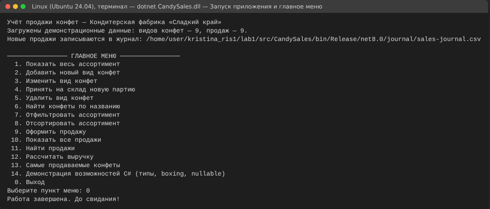

**Рисунок 2.** Ассортимент с демонстрационными данными и состоянием склада

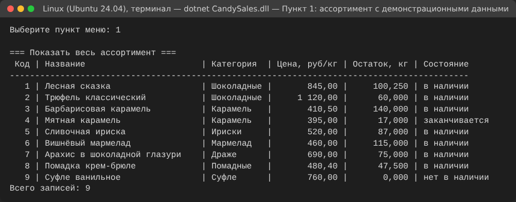

**Рисунок 3.** Добавление вида конфет: ошибки формата, отрицательной цены и лишних знаков после запятой

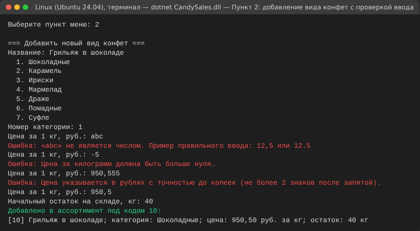

**Рисунок 4.** Изменение цены и история продаж со старой ценой

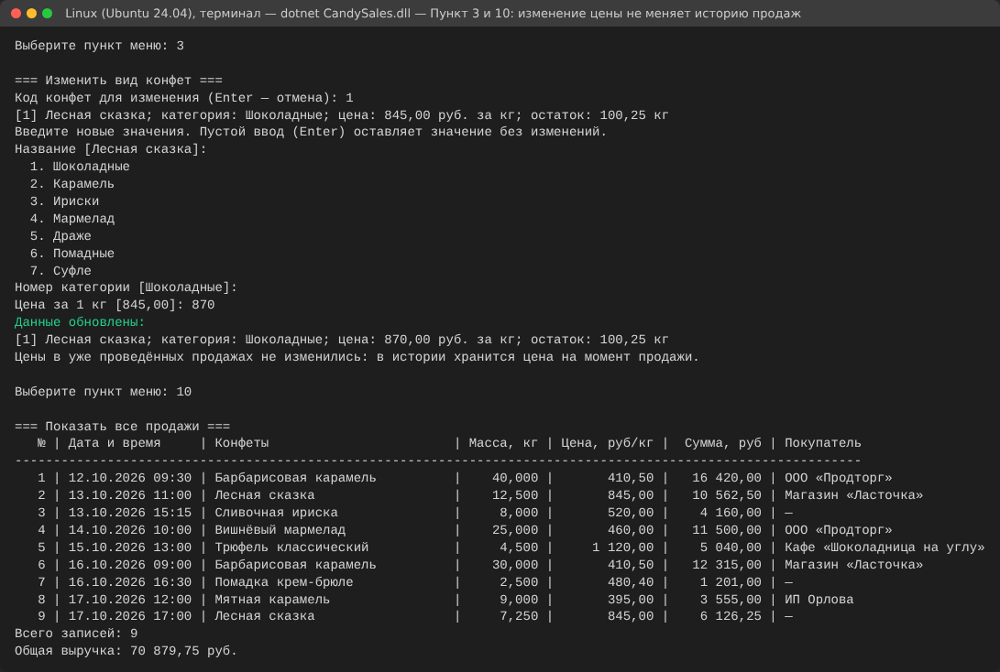

**Рисунок 5.** Приём партии (с ошибкой нулевой массы), запрет и выполнение удаления

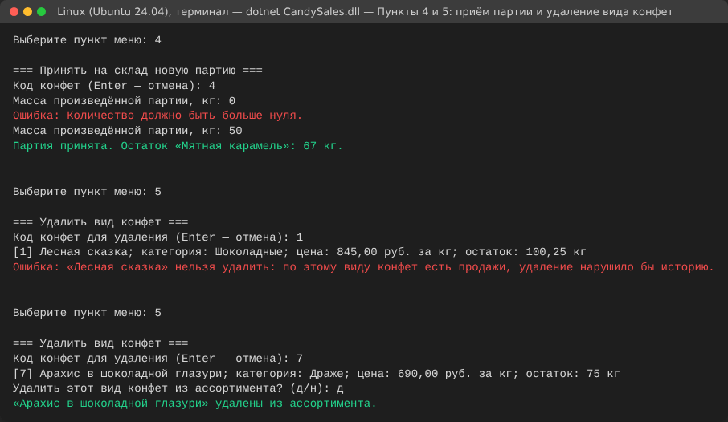

**Рисунок 6.** Поиск по названию и фильтр по диапазону цен

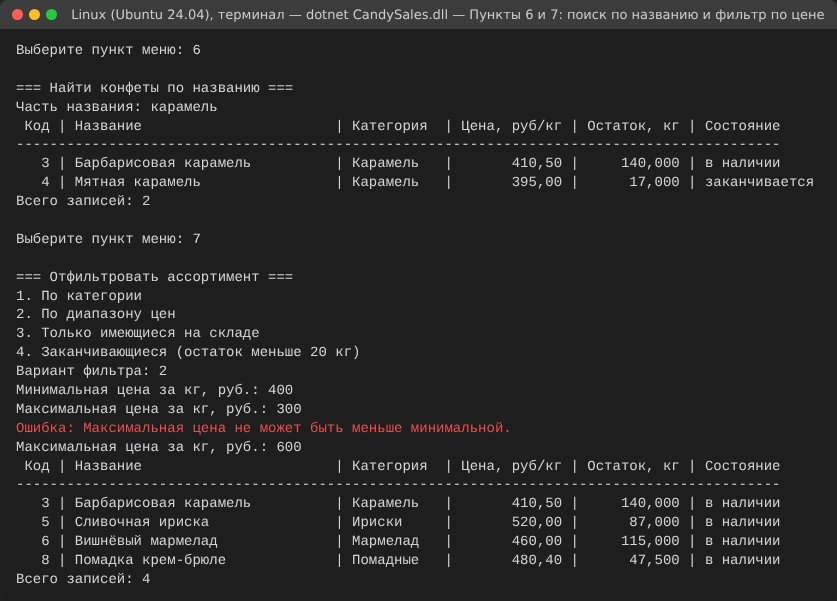

**Рисунок 7.** Сортировка по цене по убыванию

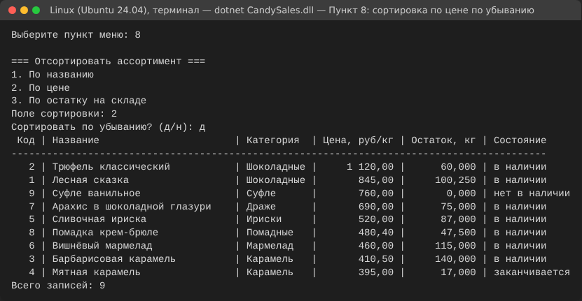

**Рисунок 8.** Оформление продажи: ошибки ввода, недостаточный остаток, событие и предупреждение об остатке,
отказ для отсутствующего товара

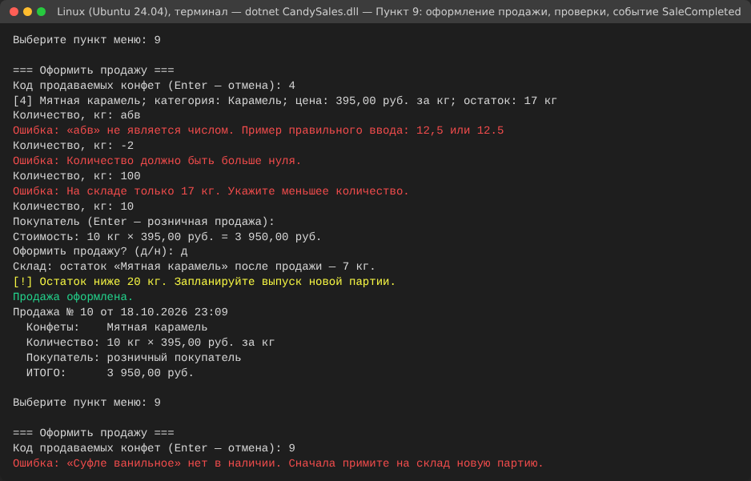

**Рисунок 9.** Поиск продаж по дате и по покупателю

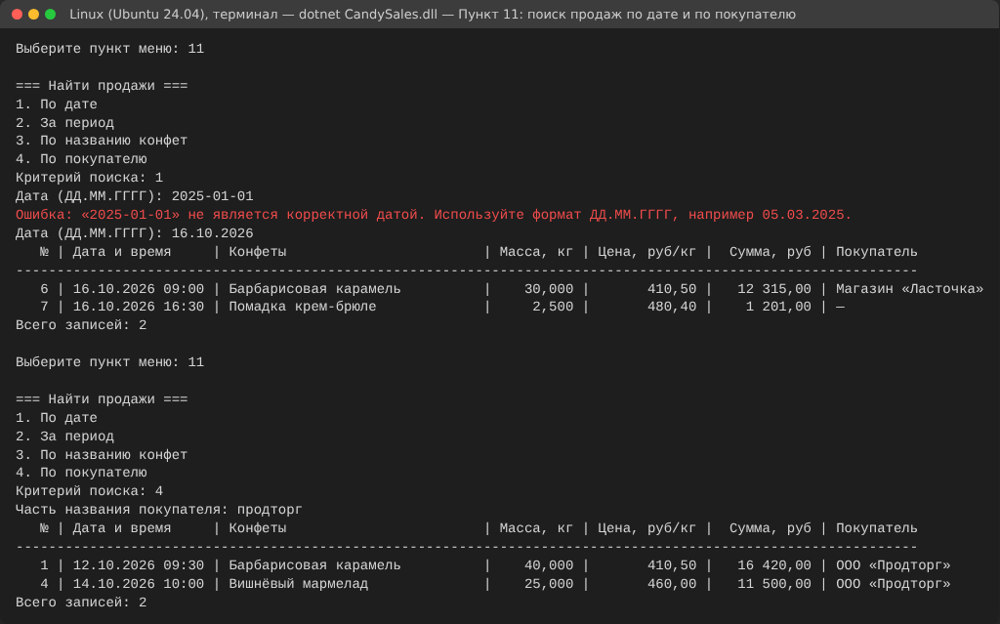

**Рисунок 10.** Выручка за период (с ошибкой порядка дат) и общая выручка

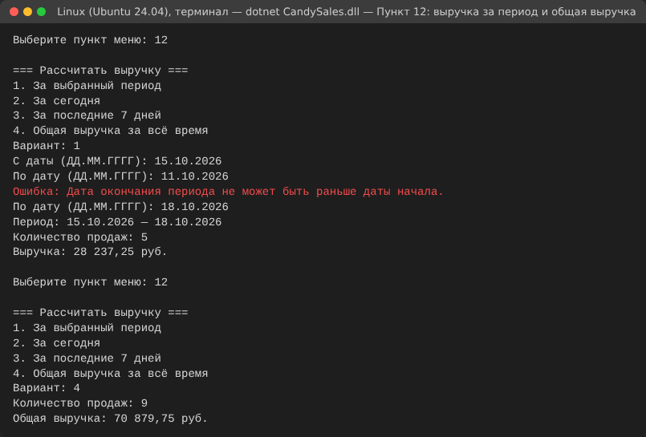

**Рисунок 11.** Самые продаваемые конфеты

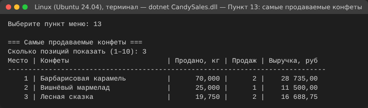

**Рисунок 12.** Демонстрация типов, boxing/unboxing, nullable-типов и pattern matching

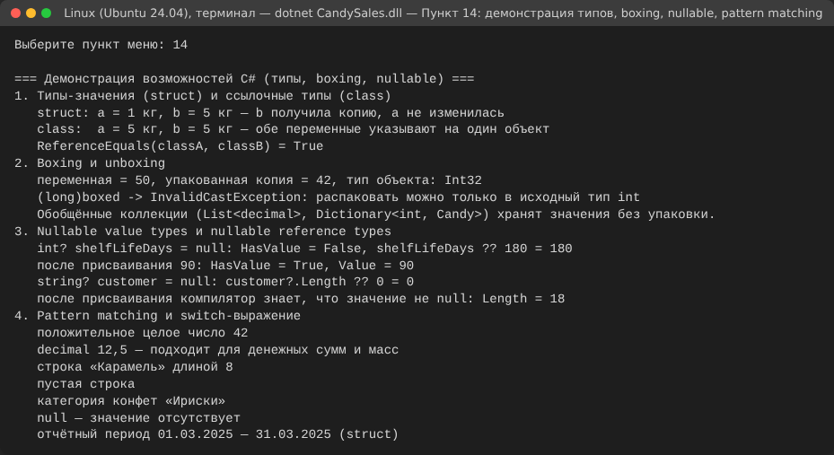

### 13.2. Windows — сделать вручную

Снимков работы в Windows нет. Перед сдачей, если требуется подтвердить работу в Windows, выполните в PowerShell
команды из раздела 10 и сохраните снимки окна терминала (Win+Shift+S) в `reports/lab1/screenshots/`:

1. `windows-01-build-test.png` — вывод `dotnet build` и `dotnet test` (0 предупреждений, 94 пройденных теста).
2. `windows-02-menu.png` — главное меню после `dotnet run`.
3. `windows-03-add-candy-cyrillic.png` — добавление конфет с названием на русском языке, например «Ромашка»
   (проверка ввода кириллицы).
4. `windows-04-sale.png` — оформление продажи с ошибочным и правильным количеством.
5. `windows-05-journal.png` — файл `journal\sales-journal.csv`, открытый в Блокноте или Excel.
6. `windows-06-actions.png` — по желанию: страница успешного запуска workflow в GitHub Actions.

## 14. Контрольные вопросы

**1. Что такое CLR и какие задачи она решает?**
Среда выполнения .NET: загрузка сборок, JIT-компиляция CIL в машинный код, управление памятью и сборка мусора,
обработка исключений, контроль типов, потоки, взаимодействие с неуправляемым кодом.

**2. Чем CTS отличается от CLS?**
CTS описывает все типы и правила, которые поддерживает среда выполнения. CLS — подмножество CTS, которое обязаны
поддерживать все .NET-языки; соответствие CLS гарантирует, что открытый API библиотеки можно использовать из
любого языка (например, без беззнаковых типов в открытых сигнатурах).

**3. Что содержит сборка?**
CIL-код, метаданные типов и манифест (имя, версия, культура, ссылки на другие сборки, список ресурсов).
Сборка — единица развёртывания и версионирования.

**4. Зачем нужен JIT-компилятор, если код уже скомпилирован?**
Компилятор C# создаёт платформенно-независимый CIL. JIT переводит его в машинный код конкретного процессора при
первом вызове метода, может учитывать возможности процессора и профиль выполнения (многоуровневая компиляция).

**5. Как работает сборщик мусора и почему он не заменяет `Dispose`?**
GC с поколениями (0, 1, 2) находит недостижимые объекты и освобождает их память в недетерминированный момент.
Ресурсы ОС (файлы, соединения) нужно закрывать сразу после использования, поэтому для них есть `IDisposable`.

**6. Чем тип-значение отличается от ссылочного типа?**
Переменная типа-значения хранит данные, присваивание копирует значение; переменная ссылочного типа хранит ссылку
на объект в куче, присваивание копирует ссылку. В работе: `SalesPeriod` (struct) и `Candy` (class).

**7. Когда выбирать `struct`, а когда `class`?**
`struct` — для небольших неизменяемых значений без идентичности (период, координата, денежная сумма). `class` —
для сущностей с идентичностью и изменяемым состоянием (вид конфет, фабрика) и для больших объектов.

**8. Что такое boxing и чем он плох?**
Упаковка типа-значения в объект кучи при приведении к `object` или интерфейсу. Требует выделения памяти и
копирования, создаёт нагрузку на GC; распаковка требует явного приведения к точному типу. Обобщённые коллекции
позволяют её избежать.

**9. Что означают `int?` и `string?`?**
`int?` — `Nullable<int>`, отдельный тип-значение со свойствами `HasValue`/`Value`. `string?` — тот же тип
`string`, но с аннотацией «может быть null» для статического анализа компилятора при включённых nullable
reference types.

**10. Чем свойство отличается от поля и от пары методов get/set в Java?**
Поле хранит данные. Свойство — член типа с аксессорами, в которых можно проверять значения; вызывается
синтаксисом поля. В Java свойств нет — используются методы `getX()/setX()` по соглашению.

**11. Чем `init` отличается от `set` и что даёт `required`?**
`init` разрешает присваивание только при создании объекта (в конструкторе или инициализаторе), после чего
свойство только для чтения. `required` заставляет вызывающий код обязательно задать свойство в инициализаторе
объекта — иначе ошибка компиляции.

**12. Для чего нужен `nameof`?**
Возвращает имя переменной, типа или члена строкой на этапе компиляции; при переименовании имя обновляется
автоматически (параметры исключений, заголовок CSV в журнале).

**13. Чем switch-выражение отличается от оператора `switch`?**
Switch-выражение возвращает значение, состоит из ветвей «шаблон => выражение», компилятор проверяет полноту
обработки; поддерживает шаблоны типов, свойств, относительные и логические (`and`, `or`, `not`).

**14. Чем отличаются `Func<>`, `Action<>`, `Predicate<>`?**
`Func<T1, ..., TResult>` возвращает значение, `Action<T1, ...>` ничего не возвращает, `Predicate<T>` принимает
`T` и возвращает `bool` (условие). В работе: `Func<DateTime>` — часы, `Action<T>` — вывод строки,
`Predicate<Candy>` — фильтр.

**15. Что такое событие и чем оно отличается от поля-делегата?**
Событие — член типа на основе делегата, к которому извне можно только подписаться (`+=`) или отписаться (`-=`);
вызвать событие или заменить список подписчиков может только объявивший его класс.

**16. Что делает `using` с `IDisposable`?**
Гарантирует вызов `Dispose()` при выходе из блока или области видимости, в том числе при исключении
(компилируется в `try/finally`).

**17. Почему для денег используется `decimal`, а не `double`?**
`decimal` хранит число в десятичной системе (28–29 значащих цифр) и точно представляет суммы с копейками;
`double` — двоичный тип, в котором `0,1` не представимо точно, что приводит к ошибкам округления.

**18. Почему нельзя писать пустой `catch` или перехватывать все исключения?**
Это скрывает ошибки, в том числе ошибки программиста, и оставляет программу в неизвестном состоянии.
Перехватывать нужно только ожидаемые исключения, которые можно корректно обработать.

## 15. Выводы

В ходе работы разработано консольное приложение учёта продажи конфет кондитерской фабрикой на C# 12 и .NET 8.
Приложение ведёт ассортимент и остатки, оформляет продажи с проверкой количества и остатка, хранит неизменяемую
историю продаж с ценой на момент продажи, ищет и фильтрует данные, считает выручку и строит рейтинг продаж.
Предметная логика отделена от консольного интерфейса и покрыта 94 автоматическими тестовыми случаями, которые
проходят в Linux; сборка выполняется без предупреждений компилятора.

На практике применены изученные возможности: типы-значения (`readonly struct`, `record struct`) и ссылочные
типы, nullable-типы, свойства с `get`/`set`/`init`/`required`, `var`, интерполяция строк, `nameof`, директивы и
объявления `using`, pattern matching и switch-выражения, массивы, `List<T>`, `Dictionary<TKey, TValue>`,
`IEnumerable<T>`, `foreach`, базовые `Where`/`OrderBy`, делегаты `Func<>`, `Action<>`, `Predicate<>`, лямбды и
замыкания, событие `SaleCompleted`, освобождение файла журнала через `IDisposable` и `using`, обработка ожидаемых
исключений с понятными сообщениями. Упаковка показана в изолированном учебном примере. Рассмотрена архитектура
.NET и её отличия от JVM.

Проект подготовлен для Linux и Windows: работа в Linux проверена непосредственно, сборка, тесты и запуск в Windows
успешно прошли в GitHub Actions на `windows-latest` (п. 11.3); интерактивную работу в консоли Windows необходимо
проверить вручную.
